<!-- ============ HEADER (custom animated SVG in /assets) ============ -->
<p align="center">
  
</p>

<p align="center">
  <a href="https://github.com/QURSAM-70179225">
    
  </a>
</p>

<p align="center">
  
  
  
    
</p>

<p align="center">
  <a href="https://dreamverseai.netlify.app"></a>
  <a href="https://www.linkedin.com/in/qursam-bibi-b3309b320/"></a>
  <a href="mailto:qursam21@gmail.com"></a>
  <a href="resume.pdf"></a>
</p>

---

##  About me

<table>
<tr>
<td width="60%" valign="top">

I'm an **Information Engineering Technology** student at **The University of Lahore** (CGPA **3.89**, Honhaar merit scholar) who builds AI products end to end: the LLM layer, FastAPI backends, React and Flutter frontends, and even microcontrollers and sensors.

```yaml
name:       Qursam Bibi
role:       AI Developer & Full-Stack Engineer
education:  BS Information Engineering Technology @ UOL
focus:      [LLM apps, FastAPI microservices, React, Flutter]
shipped:    DreamVerse AI  # live on Netlify
status:     open_to_work   # internships · junior roles · freelance
hackathons: 6           # Alibaba×Alkhidmat, UOL Hacktoberfest, 10Pearls,
            #             COLABS, NASTP×MLH, Riphah Computing Cup
fun_fact:   built a whole disaster-response platform solo at a hackathon
```

</td>
<td width="40%" valign="top">

🚀 &nbsp;**Shipped** DreamVerse AI, a 3D world with an AI mentor<br><br>
🏆 &nbsp;**6 hackathons**, from Alibaba Cloud to NASTP × MLH<br><br>
🏅 &nbsp;**Honhaar Scholar**, **Alkhidmat Fellow**, **Aspire Leaders Scholar**<br><br>
🎤 &nbsp;Ran operations for **TEDx UOL** (500+ attendees)<br><br>
💼 &nbsp;**Open to work**: available now

</td>
</tr>
</table>

---

## ⚡ Skills

<h3 align="center">💻 Languages</h3>
<p align="center">
  <a href="https://skillicons.dev"></a>
</p>

<h3 align="center">🧠 AI & Data</h3>
<p align="center">
  
  
  
  
  
  <br>
  
  
  
  
  
</p>

<h3 align="center">🎨 Frontend & Mobile</h3>
<p align="center">
  <a href="https://skillicons.dev"></a>
</p>

<h3 align="center">⚙️ Backend & Databases</h3>
<p align="center">
  <a href="https://skillicons.dev"></a>
  <br>
  
  
  
</p>

<h3 align="center">🛠️ Tools, Cloud & Hardware</h3>
<p align="center">
  <a href="https://skillicons.dev"></a>
  <br>
  
  
  
</p>

---

## 🏆 The hackathon trail

<p align="center">
  
</p>

| # | Hackathon | Organised by | What I built |
|:-:|---|---|---|
| 🛰️ | **Alibaba Cloud AI Hackathon** | Alibaba Cloud × Alkhidmat Foundation | **SafePath AI**, built solo |
| 🎃 | **Hacktoberfest Hack Day** | The University of Lahore | **Study Buddy** |
| 👩‍💻 | **Women Tech Quest** | 10Pearls Lahore | **Smart Bill Analytics** |
| 🤝 | **COLABS Hackathon** | COLABS | Participant |
| 🚀 | **NASTP × MLH Hackathon** | NASTP · Major League Hacking | Participant |
| 🏆 | **Computing Cup AI Hackathon** | Riphah International University | Participant |

---

## 🌟 Featured projects

<p align="center">
  <a href="https://dreamverseai.netlify.app"></a>
  
</p>
<p align="center">
  
  
</p>
<p align="center">
  
  
</p>

<p align="center">
  <a href="https://dreamverseai.netlify.app"></a>
  <a href="https://github.com/QURSAM-70179225/Dream-Verse"></a>
</p>

<details>
<summary><b>✨ More projects</b></summary>
<br>

| Project | What it does |
|---|---|
| [Prompt Engineering Showcase](https://github.com/QURSAM-70179225/prompt-engineering-showcase) | Zero-shot, few-shot and chain-of-thought prompts across 10 use cases |
| [AI Story & Content Generator](https://github.com/QURSAM-70179225/TechNova-ai-story-generator) | Turns LLM output into stories, blogs and poems |
| [AI Text Summarizer](https://github.com/QURSAM-70179225/Novatech_ai-text-summarizer) | Real-time summarization with Hugging Face pipelines |
| Automated Zone Evacuation System | An embedded robot that navigates with distance sensors |
| School Management System | A C++ OOP back end for users and grading |
| Encryption & Decryption Tool | Classic encryption algorithms in C++ |
| Mood Canva | A responsive front-end web app in vanilla JavaScript |

</details>

---

## 📈 Experience

| | Role | Organization | When |
|:-:|---|---|---|
| 🧠 | Generative AI Intern | TechNova | Jul 2026 (completed) |
| 🐍 | Python Programming Intern | Decodelabs | Jun – Jul 2026 |
| 🩺 | Volunteer Field Assistant | World Health Organization | May 2026 |
| 🛡️ | IT Summer Intern | BugsLink TECH | Jul – Dec 2025 |

## 🎖️ Awards & fellowships

| | |
|:-:|---|
| 🏅 | **Honhaar Scholarship**: a full merit scholarship *(Sept 2026)* |
| 💚 | **Alkhidmat AI & Software Engineering Fellow** *(Sept 2026)* |
| 🎤 | **TEDx University of Lahore, Operations Lead**: 500+ attendees *(Sept 2026)* |
| 🌍 | **Aspire Leaders Scholar**, Aspire Institute *(2026)* |
| 🥇 | **1st Place**, Omecta Quiz · **6th Place**, International Essay Competition |

<details>
<summary><b>📜 Certifications</b></summary>
<br>

Python (University of Michigan) · HTML, CSS & JS (Johns Hopkins) · SQL (Coursera) · Problem-Solving (UC Irvine) · Organizational Leadership (IIM Ahmedabad) · Interpersonal Skills (IBM) · Digital Marketing (Google) · Learning Online (University of Leeds) · Professional Voice (Royal Holloway, University of London) · Aspire Leaders Program
</details>

---

## 📊 GitHub stats

<p align="center">
  
  
</p>

<p align="center">
  
</p>

<p align="center">
  
</p>

---

<p align="center">
  
</p>

<p align="center">
  
</p>
